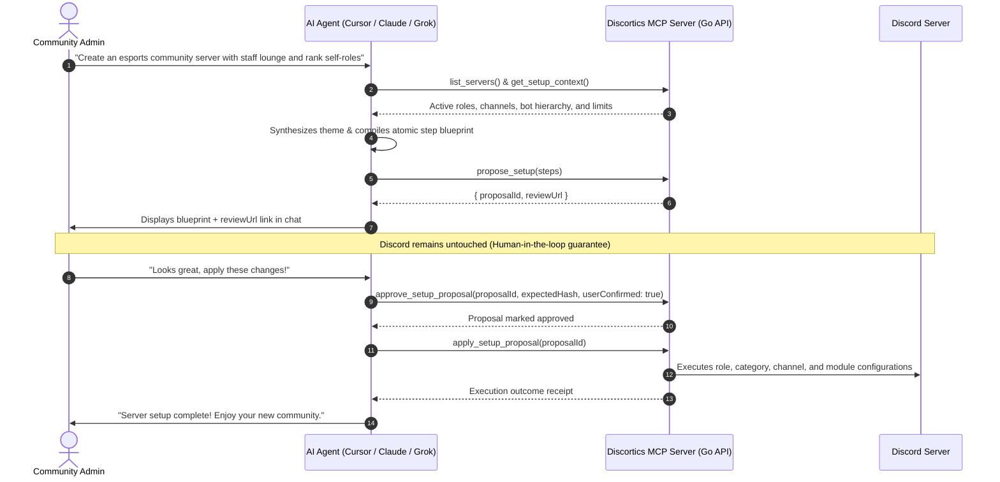

<p align="center">
  
</p>

<h1 align="center">Discortics MCP Server</h1>

<p align="center">
  <b>The Model Context Protocol (MCP) server for Discord.</b><br/>
  Architect, configure, theme, and automate Discord servers directly from your AI agent conversations.
</p>

<p align="center">
  <a href="https://modelcontextprotocol.io"></a>
  <a href="https://discortics.com"></a>
  <a href="LICENSE"></a>
  <a href="https://discord.com"></a>
  <a href="https://discortics.com/invite"></a>
</p>

---

## 🌟 Why Discortics MCP?

Instead of spending hours manually configuring roles, categories, channels, permissions, intake tickets, and verification gates, the **Discortics MCP Server** connects modern AI coding assistants and agents (**Claude**, **Cursor**, **Grok**, **ChatGPT**, **Windsurf**, **LobeChat**) directly to the Discord ecosystem.

Whether setting up a new server from scratch or non-destructively managing an active community with 50,000+ members:

- **Complete Thematic Architecture**: Turn natural prompts (_"Cozy anime cafe"_, _"Cyberpunk esports clan"_, _"Open-source dev community"_) into harmonized channel hierarchies, unicode styling, topic banners, and matching role palettes.
- **Orchestrate 20+ Modules**: Configure Verification gates, Support Tickets, Staff Applications, Button/Dropdown Self-Roles, Welcome/Leave onboarding, Starboards, Leveling, and Economy.
- **Run Day-to-Day Operations**: Start, schedule or milestone-end giveaways, read and score pending applications then accept or deny them one approved step at a time, and check why an automation run failed.
- **Any Channel Type**: Create text, voice, forum and stage channels (forum and stage need a Community server).
- **Security & Anti-Raid Shields**: Run deep security audits and deploy AntiNuke burst protection, link restrictions, and automated AutoPilot spam defenses.
- **Human-in-the-Loop Safety**: Zero mutations occur without human approval. Every architectural plan generates an immutable preview URL (`https://discortics.com/mcp/review/<id>`). The agent summarizes the changes and waits for explicit chat confirmation before applying them. Zero automated Administrator roles are ever created.

---

## 🔄 How It Works



---

## 🚀 Quickstart & Client Setup

The Discortics MCP Server runs over **Streamable HTTP** with **OAuth 2.0 PKCE** dynamic discovery. No local binaries or heavy runtimes are required.

### 1. Cursor

Add Discortics to your Cursor MCP settings (`~/.cursor/mcp.json` or project `.cursor/mcp.json`):

```json
{
  "mcpServers": {
    "discortics": {
      "type": "streamable-http",
      "url": "https://api.discortics.com/mcp"
    }
  }
}
```

---

### 2. Claude Code CLI

Add the connector in one command:

```bash
claude mcp add --transport http discortics https://api.discortics.com/mcp
```

---

### 3. Claude Desktop

1. Open **Claude Settings** → **Connectors** (or **Developer**).
2. Click **Add Connector**.
3. Set the Remote MCP URL to `https://api.discortics.com/mcp`.
4. Sign in with Discord to grant access to your server.

---

### 4. Windsurf

Add to `~/.codeium/windsurf/mcp_config.json`:

```json
{
  "mcpServers": {
    "discortics": {
      "serverUrl": "https://api.discortics.com/mcp"
    }
  }
}
```

---

### 5. Gemini CLI

Install the extension directly into Gemini CLI:

```bash
gemini extensions install Discortics/discortics-mcp
```

---

### 6. LobeHub / LobeChat

In LobeChat, search for **Discortics** in the Marketplace or add a custom remote server:

- **Server URL**: `https://api.discortics.com/mcp`
- **Transport**: `Streamable HTTP`

---

### 7. Generic MCP Client (Streamable HTTP)

- **Endpoint**: `https://api.discortics.com/mcp`
- **Transport**: `Streamable HTTP` (POST JSON-RPC 2.0 + SSE streaming)
- **Auth**: RFC 9470 OAuth Protected Resource (`https://api.discortics.com/.well-known/oauth-protected-resource/mcp`)

---

## 💬 Prompt Gallery (Try These!)

Once connected to your agent, try pasting any of these prompts:

<details>
<summary><b>🎮 Esports & Gaming Clan Setup</b></summary>

> _"I want to set up an esports community server for our Valorant team called 'Team Phantom'. Create categories for info, general chat, and a private staff lounge. Add a welcome message in general chat and self-roles for rank selection."_

</details>

<details>
<summary><b>📺 Twitch Streamer & Creator Hub</b></summary>

> _"Configure my Discord server for my Twitch streaming community. Set up a starboard with a 5-star threshold, celebratory booster announcement messages, and an ideas suggestion channel."_

</details>

<details>
<summary><b>🛠️ Open-Source Developer Support & Tickets</b></summary>

> _"Set up our developer server with a support ticket panel for 'Bug Reports' and 'Contributor Applications', and restrict the ticket review channel to our Maintainer role."_

</details>

<details>
<summary><b>🛡️ Security Audit & Raid Shield Hardening</b></summary>

> _"Audit my server's security and enable strong AntiNuke protections and automated raid defenses."_

</details>

<details>
<summary><b>⚡ Non-Destructive Incremental Upgrade</b></summary>

> _"We already have an active server. Just add a new Self-Role panel for notification pings in our existing #announcements channel without touching any existing channels or roles."_

</details>

<details>
<summary><b>🎁 Giveaways</b></summary>

> _"Start a Nitro giveaway in #giveaways this Friday at 6pm with two winners, and another one that ends when we hit 1,000 members."_

</details>

<details>
<summary><b>📝 Staff Application Review</b></summary>

> _"Go through the pending staff applications, rank them against our mod requirements, then accept the top two."_

</details>

<details>
<summary><b>🔍 Automation Troubleshooting</b></summary>

> _"Why did my daily reminder automation fail last night?"_

</details>

---

## 🛠️ Available MCP Tools

| Tool                     | Type         | Description                                                                   |
| :----------------------- | :----------- | :---------------------------------------------------------------------------- |
| `list_servers`           | Read-only    | List Discord servers authorized in the active OAuth grant                     |
| `get_setup_context`      | Read-only    | Read live roles, channels, bot permissions, and tier limits                   |
| `list_features`          | Read-only    | Enumerate available Discortics configuration modules                          |
| `get_feature_guide`      | Read-only    | Fetch operation schemas, questions, and parameter guides                      |
| `read_configuration`     | Read-only    | Retrieve module settings for an authorized guild                              |
| `audit_configuration`    | Read-only    | Batch-audit multiple server modules in a single call                          |
| `propose_setup`          | Draft (Safe) | Create an atomic setup proposal and return a cryptographic review preview URL |
| `get_setup_proposal`     | Read-only    | Inspect step status and outcomes of a stored proposal                         |
| `approve_setup_proposal` | Confirmation | Record explicit chat confirmation for the exact proposal hash                 |
| `apply_setup_proposal`   | Execution    | Execute approved configuration steps in Discord                               |

---

## 🧠 Master Agent Skill Included

This repository packages the authoritative **`discord-server-architect`** skill located at [`skills/discord-server-architect/`](skills/discord-server-architect/):

- **Thematic Blueprints**: Presets for gaming clans, creator streams, anime cafes, study groups, crypto DAOs, and tech hubs.
- **Permission Isolation Matrix**: Guarantees staff lounges, ticket transcripts, and admin channels never accidentally leak to `@everyone`.
- **Atomic References**: Automatically resolves dependencies across steps (e.g. referencing newly created role IDs in channel permission overwrites).

---

## 🔒 Security & Privacy Invariants

1. **Human Review Invariant**: No mutations touch Discord until an authorized administrator confirms the proposal in chat.
2. **Zero Administrator Roles**: Automated setup creates cosmetic, structural, or organizational roles with least-privilege permissions. Elevated admin rights remain strictly under manual owner control in Discord.
3. **No Credential Exposure**: The MCP server never handles Discord bot tokens, passwords, or personal credentials.
4. **Tenant Isolation**: OAuth grants bind directly to the user's authenticated identity and explicitly selected Discord servers.

---

## 🌐 Community & Ecosystem

- **Website**: [discortics.com](https://discortics.com)
- **Documentation**: [discortics.com/support](https://discortics.com/support)
- **Discord Bot Invite**: [discortics.com/invite](https://discortics.com/invite)
- **Registry Identifier**: `io.github.discortics/discortics`

---

## 📄 License

This repository is licensed under the [MIT License](LICENSE).
